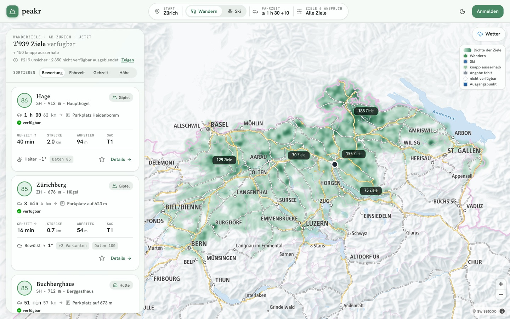
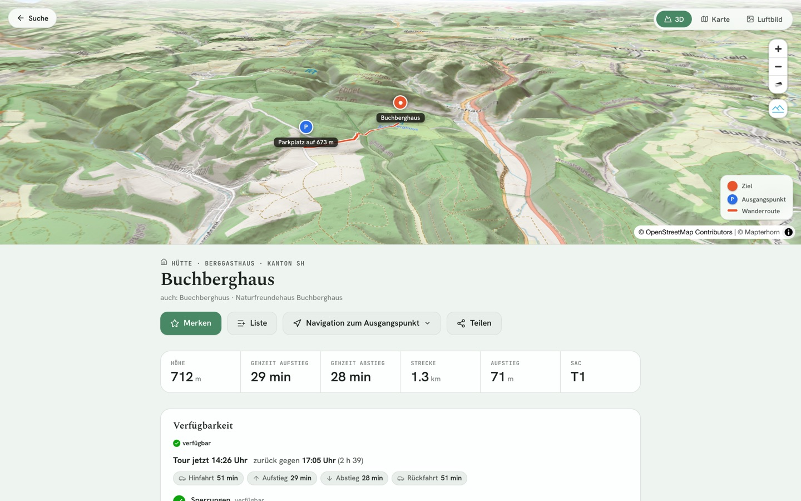
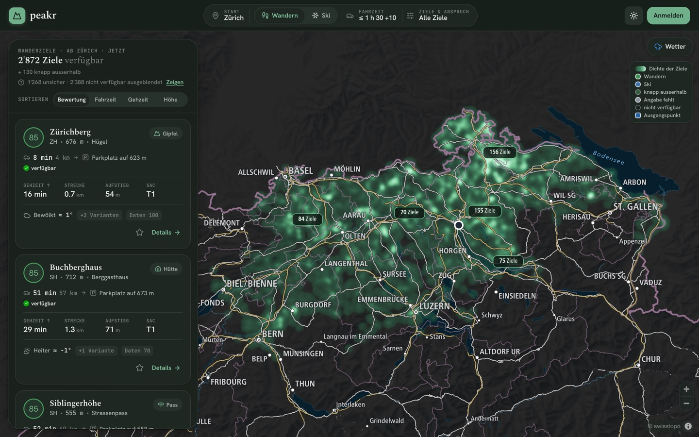
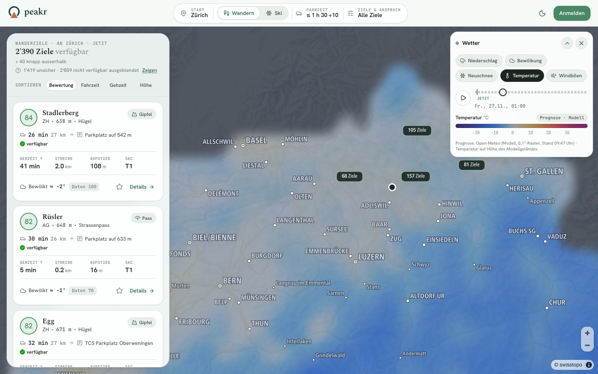
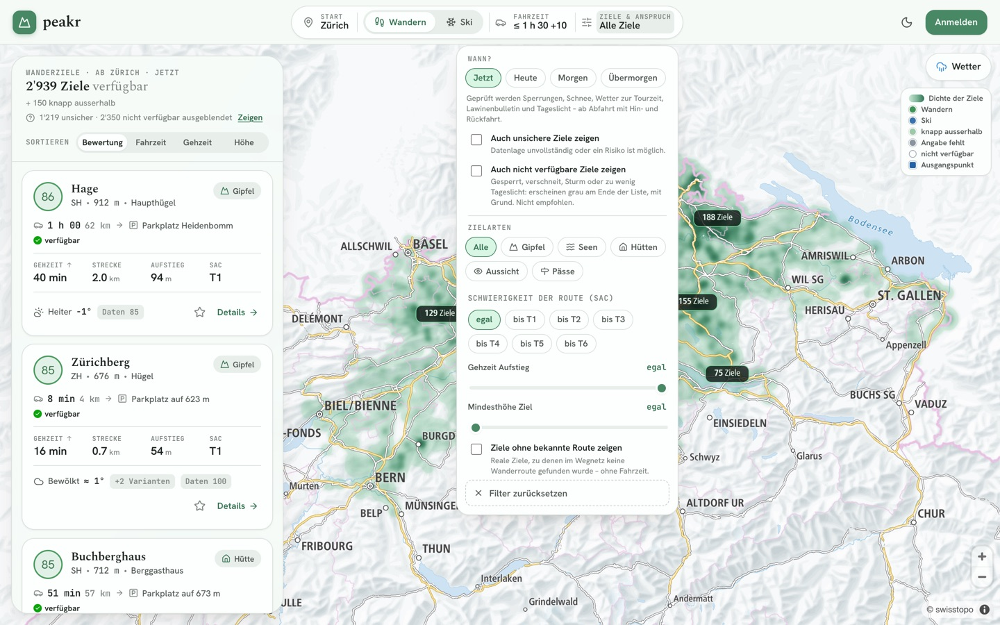
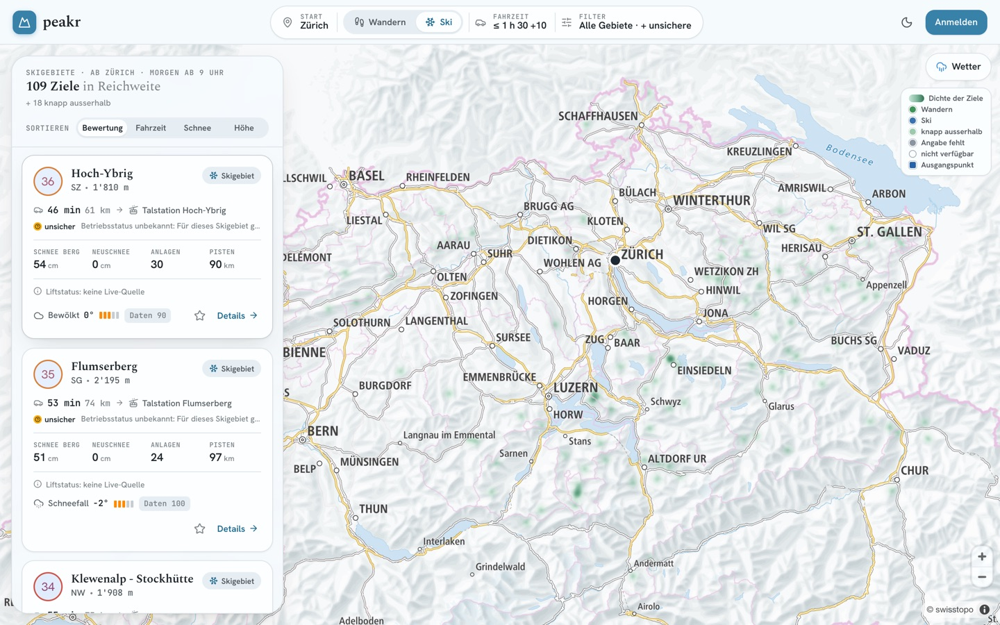
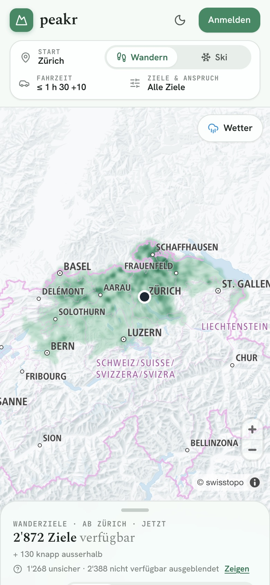
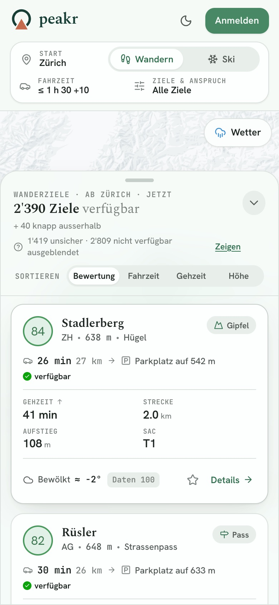

<p align="center">
  
</p>

<h1 align="center">Peakr</h1>
<p align="center"><strong>Wohin heute in die Berge?</strong></p>
<p align="center">Ski- und Wander-Navigator für die Schweiz – nach echter Autofahrzeit, Route, Wetter, Schnee und Lawinenlage.</p>
<p align="center"><a href="https://peakr-ch.vercel.app"><strong>peakr-ch.vercel.app</strong></a></p>



Du gibst Startort, maximale Autofahrzeit und die Art der Ziele an. Peakr zeigt **alle** Gipfel, Seen,
Hütten, Aussichtspunkte und Pässe bzw. Skigebiete, die du in dieser Zeit über das Strassennetz
erreichst – mit Parkplatz, Wanderroute, Gehzeit, Höhenmetern, SAC-Schwierigkeit und aktuellen
Bedingungen. Peakr prüft, ob ein Ziel zur geplanten Zeit überhaupt machbar ist (Sperrungen, Schnee,
Wetter, Lawinen, Tageslicht), und blendet den Rest aus – auf Wunsch mit Grund wieder ein. Alles läuft
mit kostenlosen, offenen Daten; es gibt keine kostenpflichtige Schnittstelle.

## Was Peakr kann

| Bereich | Funktionen |
|---|---|
| **Suche** | Startort per Ortssuche (swisstopo) oder GPS · Fahrzeit 15–240 min plus Toleranz · Wandern oder Ski · Zeitpunkt «Jetzt», heute, morgen oder übermorgen |
| **Wandern** | Mehrere Zielarten gleichzeitig · SAC-Filter T1–T6 auf die **gewählte Route** · max. Gehzeit · Mindesthöhe · Ziele ohne bekannte Route optional |
| **Ski** | 317 Skigebiete aus OpenStreetMap, gruppiert · Fahrzeit bis zur Talstation · Schnee Tal/Berg, Neuschnee, Wetter, Lawinenstufe · Mindestschneehöhe · geplant wird der heutige bzw. ab 14 Uhr der morgige Skitag |
| **Verfügbarkeit** | Standardmässig nur Ziele, die zur geplanten Zeit verfügbar sind: Wegsperrungen, Schnee entlang der Route (Messstationen, als Beleg die nächstgelegene), Wetter zur Tourzeit, Lawinenbulletin nach Höhenlage, Tageslicht · Tageslicht und Wetterfenster ab Ankunft am Ausgangspunkt · Skigebiete nie «offen» ohne Live-Betriebsstatus · Gründe je Ziel |
| **Ausgeblendete Ziele** | Listenkopf nennt, was fehlt («1'219 unsicher · 2'350 nicht verfügbar ausgeblendet · Zeigen») · zuerst unsichere, dann auch nicht verfügbare einblenden · nicht verfügbare stehen gedämpft am Ende jedes Abschnitts und erscheinen grau auf der Karte |
| **Wetterkarte** | Schalter «Wetter» auf der Karte: Radar MeteoSchweiz (gemessen, 5 min) und Prognose bis 48 h für Niederschlag, Bewölkung, Neuschnee, Temperatur, Böen · fliessende Verläufe · läuft auch bei zugeklappten Einstellungen weiter · Böen als ziehende Striche, Neuschnee als Flocken · Zeitleiste mit Pause · Legende |
| **Ergebnisse** | Abschnitte «in Reichweite», «knapp ausserhalb», «Schwierigkeit unbekannt», «ohne Route» · Sortierung nach Bewertung, Fahrzeit, Gehzeit, Höhe, Schnee · seitenweise, ohne Obergrenze |
| **Karte** | swisstopo-Karte, hell oder als echte dunkle Variante (umgefärbt, nicht nur abgedunkelt) · Dichte der Treffer als organische Heatmap in Mint (GPU, Web Worker) · auf mittlerem Zoom echte Hotspot-Zahlen («155 Ziele»), nah die Einzelziele · Heatmap und Kartenausschnitt nur aus Treffern innerhalb der Fahrzeit · gewählte Route und Parkplatz eingezeichnet · Wanderwege-Overlay · Feuerstellen |
| **Detail** | 3D-Gelände, Karte, Luftbild · «Tour jetzt 14:26 Uhr · zurück gegen 17:05 Uhr» mit Hinfahrt, Aufstieg, Abstieg und Rückfahrt, laufend nachgerechnet · alle Routenvarianten mit eigener Fahrzeit · Route an die swisstopo-App übergeben (mit Start, Ziel und Wegpunkten) · GPX-Download · Navigation zum Ausgangspunkt · Teilen (Link kopieren oder System-Teilen) · 7-Tage-Prognose |
| **Listen** | Eigene Listen anlegen und per Link einladen · alle Mitglieder fügen Ziele hinzu oder entfernen sie · umbenennen und löschen nur die Besitzerin bzw. der Besitzer · andere sehen nur Anzeigenamen |
| **Konto** | Registrierung, Favoriten, Standard-Startort; ohne Konto Favoriten im Browser |
| **Mobil** | Ergebnisliste als wischbares Fenster über der Karte · Statusleiste in den Farben der App (hell/dunkel) · Icon für den Home-Bildschirm (iOS und Android) |

Fehlende Angaben bleiben sichtbar fehlend: unbekannte Schwierigkeit heisst «unbekannt», ohne
Strassenroute gibt es keine Fahrzeit, ohne Live-Quelle keinen Liftstatus.

<table>
  <tr>
    <th>Detail: Tour ab jetzt, Teilen, Liste</th>
    <th>Dunkle Karte</th>
    <th>Wetterkarte</th>
  </tr>
  <tr>
    <td></td>
    <td></td>
    <td></td>
  </tr>
  <tr>
    <th>Wann, Verfügbarkeit, Filter</th>
    <th>Ski</th>
    <th>Mobil: Karte und Liste</th>
  </tr>
  <tr>
    <td></td>
    <td></td>
    <td>
      
      
    </td>
  </tr>
</table>

## So funktioniert es

```
Startort ──► Strassengraph (OSM, im Server-Speicher) ──► Fahrzeit zu jedem erreichbaren Strassenknoten
                                                            │
PostGIS: Ausgangspunkte im erreichten Gebiet ◄──────────────┘   (räumlicher Vorfilter, ohne LIMIT)
   │
   ├─ Wandern: vorberechnete Routen Parkplatz → Ziel (bis 3 Varianten je Ziel)
   │           Fahrzeit des Parkplatzes + SAC/Gehzeit-Filter je Variante → beste passende Variante
   └─ Ski:     Talstation je Skigebiet
   │
   ▼
Verfügbarkeit zur geplanten Zeit (Sperrung · Schnee · Wetter · Lawine · Tageslicht)
   │
   ▼
Abschnitte (≤ Limit · ≤ Limit+Toleranz · SAC unbekannt · ohne Route) → Bewertung → Seite + alle Kartenpunkte
```

- **Fahrzeit:** eigener Strassengraph aus OpenStreetMap (1,4 Mio. Knoten, 40 MB), Dijkstra je Suche
  in 0,1–0,7 s. Gerechnet wird zum Parkplatz bzw. zur Talstation, nie zum Gipfel. Im Vergleich mit
  OpenRouteService weichen 478 Strecken im Median um 2,6 % ab (90 % innerhalb ±10 %). Keine API-Limits,
  keine Kosten, keine Luftlinien-Schätzung.
- **Ziele:** rund 19'000 aus swisstopo swissNAMES3D (amtlich, führend) plus OpenStreetMap, mit
  Duplikaterkennung. Keine Mindesthöhe, kein Ausschluss wegen fehlender Wege.
- **Routen:** rund 22'000, berechnet auf dem Wegnetz aus OpenStreetMap, ergänzt um die amtlichen
  Wanderwege (swissTLM3D) mit ihrer Signalisation; Höhen aus einem Geländemodell, Gehzeit nach DIN 33466.
- **Live-Daten:** Open-Meteo (Wetter, Schnee, stündliche Prognose), SLF (Lawinenbulletin, IMIS-Stationen),
  MeteoSchweiz (Schneemessnetz, Niederschlagsradar), Wegsperrungen von ASTRA und Schweizer Wanderwege
  (geo.admin.ch) – per GitHub Actions alle 3–6 Stunden, das Radar live beim Öffnen der Wetterkarte.
- **Karte:** Die Dichte der Treffer rechnet ein Web Worker (`apps/frontend/lib/density`); Heatmap,
  Hotspots und Einzelziele zeichnet MapLibre als GPU-Ebenen.

Details: [Architektur](docs/ARCHITEKTUR.md) · [Verfügbarkeit und Wetter](docs/VERFUEGBARKEIT_UND_WETTER.md) ·
[GPX und swisstopo](docs/GPX_UND_SWISSTOPO.md) · [Quellen und Lizenzen](docs/DATENQUELLEN.md) ·
[Abdeckung](docs/DATENQUALITAET.md)

## Lokal starten

Voraussetzungen: Node.js ≥ 22.13, pnpm 9, Docker (oder ein PostgreSQL 16 mit PostGIS),
`osmium-tool` und `unzip` (macOS: `brew install osmium-tool`), rund 4 GB freier Speicher.

```bash
pnpm install
cp .env.example .env                 # JWT_SECRET setzen

docker compose up -d db              # PostgreSQL 16 + PostGIS
pnpm db:migrate                      # Schema
pnpm pipeline all                    # Daten laden und aufbauen (~10–20 min, ~8 GB RAM)
pnpm worker ski weather trend        # Live-Daten einmal füllen

pnpm dev                             # http://localhost:3000
```

`pnpm pipeline all` lädt swissNAMES3D, die amtlichen Wanderwege und den OSM-Auszug der Schweiz
(zusammen ~800 MB) nach `.data/`, berechnet Ziele, Skigebiete, Strassengraph, Parkplätze und Routen
und schreibt alles in die Datenbank. Jeder Schritt lässt sich einzeln wiederholen:
`pnpm pipeline destinations`, `… ski`, `… network`, `… index`.

Alternativ alles in Docker: siehe Kopf von [docker-compose.yml](docker-compose.yml).

## Betrieb

Peakr läuft öffentlich unter [peakr-ch.vercel.app](https://peakr-ch.vercel.app). Der Zustand von
Datenbank, Strassengraph, Suchindex und Live-Daten-Jobs steht unter
[`/api/health`](https://peakr-ch.vercel.app/api/health).

| Teil | Wo | Kosten |
|---|---|---|
| Web-App inkl. API | Vercel (Hobby) | 0 |
| Datenbank | Neon (Free, ~110 MB von 1 GB), über die Vercel-Integration | 0 |
| Live-Daten alle 3–6 h | GitHub Actions «Peakr Worker» | 0 (öffentliches Repo) |
| Datenaufbau wöchentlich | GitHub Actions «Peakr Daten» | 0 |
| Strassengraph + Suchindex | GitHub-Release `data-latest` | 0 |

Einrichtung: [SETUP_EXTERNAL.md](SETUP_EXTERNAL.md) · Worker, Monitoring und Fehlerbehebung:
[docs/BETRIEB.md](docs/BETRIEB.md) · Was geändert wurde und warum: [Abschlussbericht](docs/ABSCHLUSSBERICHT.md)

## Befehle

```bash
pnpm dev | build | start             # Web-App
pnpm typecheck && pnpm lint          # statische Prüfung
pnpm test                            # Unit-Tests (Backend + Frontend)
pnpm test:db                         # Tests gegen die befüllte Datenbank (Testmatrix 8 Regionen)
pnpm pipeline <schritt|all>          # Datenaufbau
pnpm worker <ski|weather|trend|maintenance|schedule>
pnpm report:quality [-- --write]     # Datenqualitätsbericht
```

## Projektstruktur

```
apps/frontend/        Next.js: Oberfläche und API-Routen (dünne Hüllen um apps/backend/src/server)
  lib/density/        Dichte-Engine (Web Worker), Heatmap-, Hotspot- und Zielebenen
apps/backend/src/
  server/             die gesamte API-Logik, framework-frei
  services/           Suche, Bewertung, Detail, Auth, Listen, Wetter, Radar, SLF, Sperrungen, Schneestationen
  availability/       Verfügbarkeitsprüfung: Sperrung, Schnee, Wetter, Lawine, Tageslicht
  repositories/       SQL (postgres.js, parametrisiert)
  routing/            Strassengraph und Fahrzeit
  search/             vorberechneter Suchindex
  pipeline/           Datenaufbau: Downloads, OSM/GeoPackage-Leser, Ziele, Ski, Weg- und Strassennetz
  workers/            Live-Daten-Jobs mit Sperre, Zeitlimit, Protokoll
apps/backend/drizzle/ SQL-Migrationen
packages/shared/      Zod-Schemas und Typen der API, GPX-Erzeugung
docs/                 Audit, Abschlussbericht, Architektur, Datenquellen, Betrieb, Datenqualität,
                      Verfügbarkeit und Wetter, GPX und swisstopo, Screenshots
.github/workflows/    CI, Worker, wöchentlicher Datenaufbau
```

Die Ordner `app/`, `components/`, `lib/`, `src/`, `peakr/`, `handoff/` sowie `Peakr.html` und
`tweaks-panel.jsx` im Root sind ältere Kopien und Design-Prototypen. Sie gehören zu keinem Workspace,
werden weder gebaut noch geprüft.

## Grenzen

- **Liftstatus:** Es gibt keine freie, rechtlich saubere schweizweite Quelle. Peakr zeigt die Zahl der
  Anlagen (OSM), aber keinen Betriebsstatus; Skigebiete gelten deshalb als «unsicher». Adapter für
  einzelne Gebiete sind vorbereitet (`apps/backend/src/lifts`).
- **Sperrungen** gibt es nur für das amtliche Wanderwegnetz. Liegt eine Route teils daneben, sagt die
  Prüfung das offen, wertet die Route deswegen aber nicht ab.
- **Schnee:** Die Prüfung stützt sich auf Messstationen und Modell; Stationen jenseits eines Grats oder
  des Alpenhauptkamms können ein Tal nur ungenau abbilden.
- **Fahrzeiten** ohne Verkehrslage; Wintersperren von Passstrassen gelten ab dem wöchentlichen Neuaufbau.
- **Routen** sind aus dem Wegnetz berechnet, nicht begangen. Hochalpine Ziele über Gletscher haben im
  Wegnetz meist keinen durchgehenden Weg und erscheinen deshalb nur unter «ohne Route».
- **Lawinenstufe** ist die höchste Stufe der SLF-Region und ersetzt nicht das Bulletin auf
  [whiterisk.ch](https://whiterisk.ch).

## Lizenz und Attribution

Daten: © swisstopo (OGD), © OpenStreetMap-Mitwirkende (ODbL), Open-Meteo (CC BY 4.0),
MeteoSchweiz (CC BY 4.0), WSL-Institut für Schnee- und Lawinenforschung SLF (CC BY 4.0),
ASTRA / Schweizer Wanderwege (Sperrungen, OGD), Terrain Tiles (Mapzen/AWS), Mapterhorn (3D-Ansicht).
Einzelheiten in [docs/DATENQUELLEN.md](docs/DATENQUELLEN.md).
