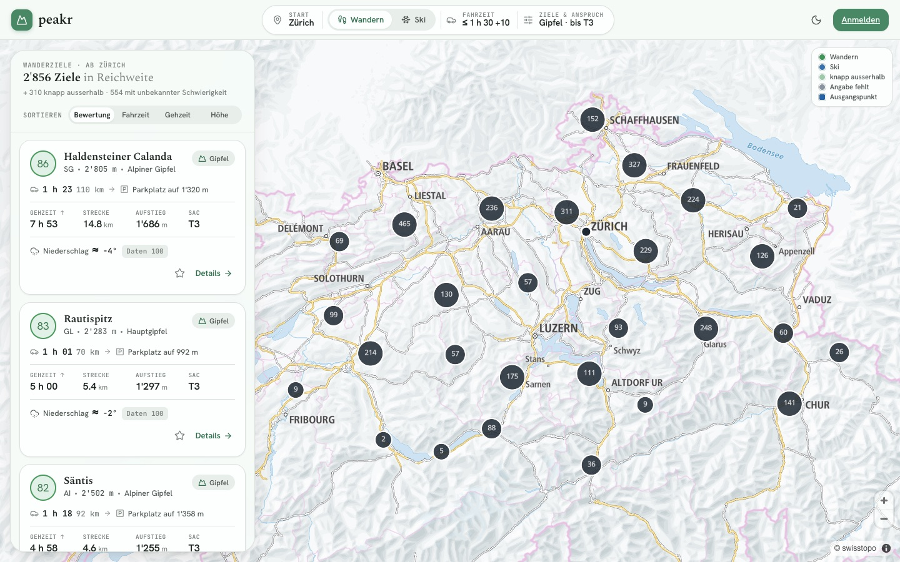
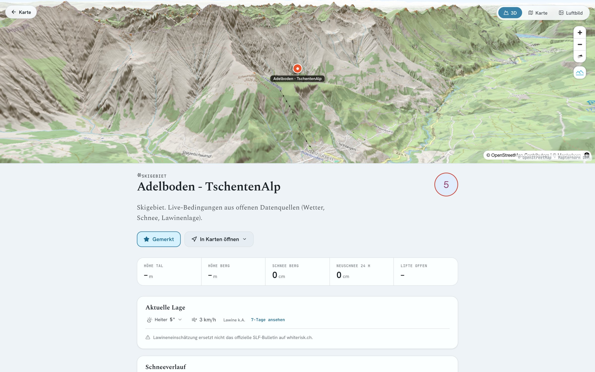
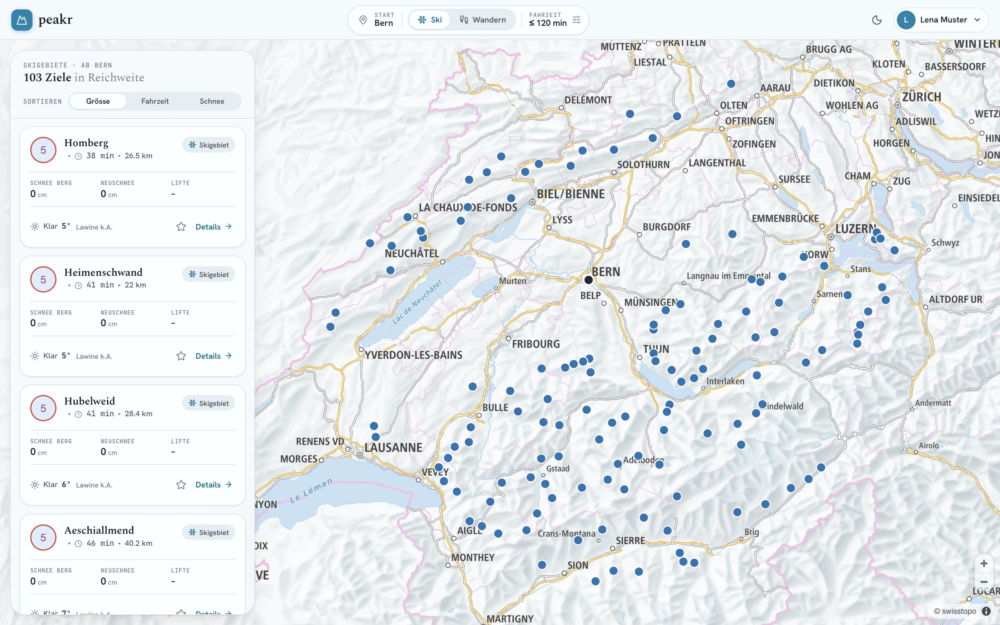
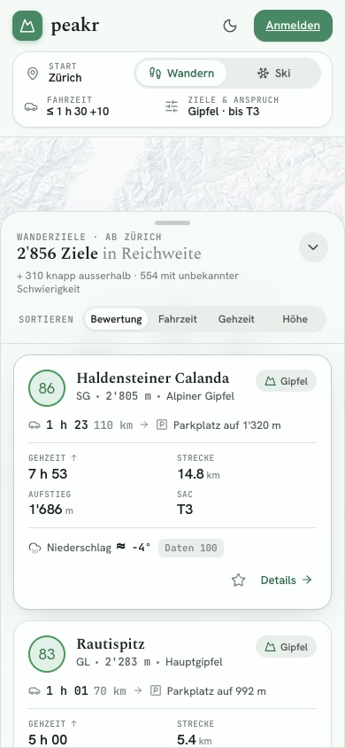

<p align="center">
  
</p>

<h1 align="center">Peakr</h1>
<p align="center"><strong>Wohin heute in die Berge?</strong></p>
<p align="center">Ski- und Wander-Navigator für die Schweiz – nach echter Autofahrzeit, Route, Wetter, Schnee und Lawinenlage.</p>

> [!NOTE]
> **Stand 13.11.2026:** Der Code ist überarbeitet, getestet und lokal voll lauffähig. Die neue
> Datenbank (Neon) ist angelegt; für den öffentlichen Betrieb folgen der erste Datenaufbau und ein
> neues Deployment – Schritt für Schritt in [SETUP_EXTERNAL.md](SETUP_EXTERNAL.md). Was geändert wurde
> und warum, steht im [Abschlussbericht](docs/ABSCHLUSSBERICHT.md).



Du gibst Startort, maximale Autofahrzeit und die Art der Ziele an. Peakr zeigt **alle** Gipfel, Seen,
Hütten, Aussichtspunkte und Pässe bzw. Skigebiete, die du in dieser Zeit über das Strassennetz
erreichst – mit Parkplatz, Wanderroute, Gehzeit, Höhenmetern, SAC-Schwierigkeit und aktuellen
Bedingungen. Alles läuft mit kostenlosen, offenen Daten; es gibt keine kostenpflichtige Schnittstelle.

## Was Peakr kann

| Bereich | Funktionen |
|---|---|
| **Suche** | Startort per Ortssuche (swisstopo) oder GPS · Fahrzeit 15–240 min plus Toleranz · Wandern oder Ski |
| **Wandern** | Mehrere Zielarten gleichzeitig · SAC-Filter T1–T6 auf die **gewählte Route** · max. Gehzeit · Mindesthöhe · Ziele ohne bekannte Route optional |
| **Ski** | 317 Skigebiete aus OpenStreetMap, gruppiert · Fahrzeit bis zur Talstation · Schnee Tal/Berg, Neuschnee, Wetter, Lawinenstufe · Mindestschneehöhe |
| **Verfügbarkeit** | Standardmässig nur Ziele, die zur geplanten Zeit verfügbar sind: Wegsperrungen, Schnee entlang der Route (Messstationen), Wetter zur Tourzeit, Lawinenbulletin nach Höhenlage, Tageslicht · Skigebiete nie «offen» ohne Live-Betriebsstatus · Unsichere optional · Gründe je Ziel |
| **Wetterkarte** | Schalter «Wetter» auf der Karte: Radar MeteoSchweiz (gemessen, 5 min) und Prognose bis 48 h für Niederschlag, Bewölkung, Neuschnee, Temperatur, Böen · fliessende Verläufe auf dunkler Karte · läuft auch bei zugeklappten Einstellungen weiter · Böen als ziehende Striche, Neuschnee als Flocken · Zeitleiste mit Pause · Legende |
| **Ergebnisse** | Abschnitte «in Reichweite», «knapp ausserhalb», «Schwierigkeit unbekannt», «ohne Route» · Sortierung nach Bewertung, Fahrzeit, Gehzeit, Höhe, Schnee · seitenweise, ohne Obergrenze |
| **Karte** | swisstopo-Karte · Zähler fassen nahe Ziele zusammen · gewählte Route und Parkplatz eingezeichnet · Wanderwege-Overlay · Feuerstellen |
| **Detail** | 3D-Gelände, Karte, Luftbild · alle Routenvarianten mit eigener Fahrzeit · Route in swisstopo öffnen · GPX-Download (Track mit Höhen, Start, Ziel, Orte am Weg) · Navigation zum Parkplatz · Anlagen und Pisten · 7-Tage-Prognose · Datenquellen |
| **Konto** | Registrierung, Favoriten, Standard-Startort; ohne Konto Favoriten im Browser |

Fehlende Angaben bleiben sichtbar fehlend: unbekannte Schwierigkeit heisst «unbekannt», ohne
Strassenroute gibt es keine Fahrzeit, ohne Live-Quelle keinen Liftstatus.

<table>
  <tr><th>Detail: Route, Anreise, Varianten</th><th>Ski</th><th>Mobil</th></tr>
  <tr>
    <td></td>
    <td></td>
    <td></td>
  </tr>
</table>

## So funktioniert es

```
Startort ──► Strassengraph (OSM, im Server-Speicher) ──► Fahrzeit zu jedem erreichbaren Strassenknoten
                                                            │
PostGIS: Ausgangspunkte im erreichten Gebiet ◄──────────────┘   (räumlicher Vorfilter, ohne LIMIT)
   │
   ├─ Wandern: vorberechnete Routen Parkplatz → Ziel (bis 3 Varianten je Ziel)
   │           Fahrzeit des Parkplatzes + SAC/Gehzeit-Filter je Variante → beste passende Variante
   └─ Ski:     Talstation je Skigebiet
   │
   ▼
Abschnitte (≤ Limit · ≤ Limit+Toleranz · SAC unbekannt · ohne Route) → Bewertung → Seite + alle Kartenpunkte
```

- **Fahrzeit:** eigener Strassengraph aus OpenStreetMap (1,4 Mio. Knoten, 40 MB), Dijkstra je Suche
  in 0,1–0,7 s. Gerechnet wird zum Parkplatz bzw. zur Talstation, nie zum Gipfel. Im Vergleich mit
  OpenRouteService weichen 478 Strecken im Median um 2,6 % ab (90 % innerhalb ±10 %). Keine API-Limits,
  keine Kosten, keine Luftlinien-Schätzung.
- **Ziele:** swisstopo swissNAMES3D (amtlich, führend) plus OpenStreetMap, mit Duplikaterkennung.
  Keine Mindesthöhe, kein Ausschluss wegen fehlender Wege.
- **Routen:** Wegnetz aus OpenStreetMap, ergänzt um die amtlichen Wanderwege (swissTLM3D) mit ihrer
  Signalisation; Höhen aus einem Geländemodell, Gehzeit nach DIN 33466.
- **Live-Daten:** Open-Meteo (Wetter, Schnee), SLF (Lawinenbulletin) – per GitHub Actions alle 3–6 Stunden.

Details: [docs/ARCHITEKTUR.md](docs/ARCHITEKTUR.md) · Quellen und Lizenzen: [docs/DATENQUELLEN.md](docs/DATENQUELLEN.md) ·
Abdeckung: [docs/DATENQUALITAET.md](docs/DATENQUALITAET.md)

## Lokal starten

Voraussetzungen: Node.js ≥ 22.13, pnpm 9, Docker (oder ein PostgreSQL 16 mit PostGIS),
`osmium-tool` und `unzip` (macOS: `brew install osmium-tool`), rund 4 GB freier Speicher.

```bash
pnpm install
cp .env.example .env                 # JWT_SECRET setzen

docker compose up -d db              # PostgreSQL 16 + PostGIS
pnpm db:migrate                      # Schema
pnpm pipeline all                    # Daten laden und aufbauen (~10–20 min, ~8 GB RAM)
pnpm worker ski weather trend        # Live-Daten einmal füllen

pnpm dev                             # http://localhost:3000
```

`pnpm pipeline all` lädt swissNAMES3D, die amtlichen Wanderwege und den OSM-Auszug der Schweiz
(zusammen ~800 MB) nach `.data/`, berechnet Ziele, Skigebiete, Strassengraph, Parkplätze und Routen
und schreibt alles in die Datenbank. Jeder Schritt lässt sich einzeln wiederholen:
`pnpm pipeline destinations`, `… ski`, `… network`, `… index`.

Alternativ alles in Docker: siehe Kopf von [docker-compose.yml](docker-compose.yml).

## Betrieb

| Teil | Wo | Kosten |
|---|---|---|
| Web-App inkl. API | Vercel (Hobby) | 0 |
| Datenbank | Neon (Free, ~110 MB von 1 GB), über die Vercel-Integration | 0 |
| Live-Daten alle 3–6 h | GitHub Actions «Peakr Worker» | 0 (öffentliches Repo) |
| Datenaufbau wöchentlich | GitHub Actions «Peakr Daten» | 0 |
| Strassengraph + Suchindex | GitHub-Release `data-latest` | 0 |

Einrichtung: [SETUP_EXTERNAL.md](SETUP_EXTERNAL.md) · Worker, Monitoring und Fehlerbehebung:
[docs/BETRIEB.md](docs/BETRIEB.md)

## Befehle

```bash
pnpm dev | build | start             # Web-App
pnpm typecheck && pnpm lint          # statische Prüfung
pnpm test                            # Unit-Tests (Backend + Frontend)
pnpm test:db                         # Tests gegen die befüllte Datenbank (Testmatrix 8 Regionen)
pnpm pipeline <schritt|all>          # Datenaufbau
pnpm worker <ski|weather|trend|maintenance|schedule>
pnpm report:quality [-- --write]     # Datenqualitätsbericht
```

## Projektstruktur

```
apps/frontend/        Next.js: Oberfläche und API-Routen (dünne Hüllen um apps/backend/src/server)
apps/backend/src/
  server/             die gesamte API-Logik, framework-frei
  services/           Suche, Bewertung, Detail, Auth, Wetter, SLF, Wikipedia
  repositories/       SQL (postgres.js, parametrisiert)
  routing/            Strassengraph und Fahrzeit
  pipeline/           Datenaufbau: Downloads, OSM/GeoPackage-Leser, Ziele, Ski, Weg- und Strassennetz
  workers/            Live-Daten-Jobs mit Sperre, Zeitlimit, Protokoll
  drizzle/            SQL-Migrationen
packages/shared/      Zod-Schemas und Typen der API
docs/                 Audit, Abschlussbericht, Architektur, Datenquellen, Betrieb, Datenqualität
.github/workflows/    CI, Worker, wöchentlicher Datenaufbau
```

Die Ordner `app/`, `components/`, `lib/`, `src/`, `peakr/`, `handoff/` sowie `Peakr.html` und
`tweaks-panel.jsx` im Root sind ältere Kopien und Design-Prototypen. Sie gehören zu keinem Workspace,
werden weder gebaut noch geprüft.

## Grenzen

- **Liftstatus:** Es gibt keine freie, rechtlich saubere schweizweite Quelle. Peakr zeigt die Zahl der
  Anlagen (OSM), aber keinen Betriebsstatus. Adapter für einzelne Gebiete sind vorbereitet
  (`apps/backend/src/lifts`).
- **Fahrzeiten** ohne Verkehrslage; Wintersperren von Passstrassen gelten ab dem wöchentlichen Neuaufbau.
- **Routen** sind aus dem Wegnetz berechnet, nicht begangen. Hochalpine Ziele über Gletscher haben im
  Wegnetz meist keinen durchgehenden Weg und erscheinen deshalb nur unter «ohne Route».
- **Lawinenstufe** ist die höchste Stufe der SLF-Region und ersetzt nicht das Bulletin auf
  [whiterisk.ch](https://whiterisk.ch).

## Lizenz und Attribution

Daten: © swisstopo (OGD), © OpenStreetMap-Mitwirkende (ODbL), Open-Meteo (CC BY 4.0),
WSL-Institut für Schnee- und Lawinenforschung SLF, Terrain Tiles (Mapzen/AWS). Einzelheiten in
[docs/DATENQUELLEN.md](docs/DATENQUELLEN.md).
