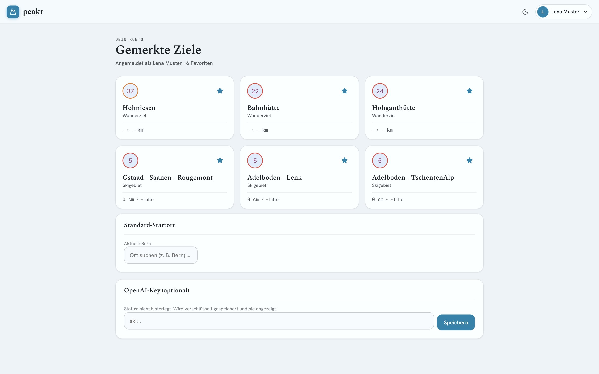
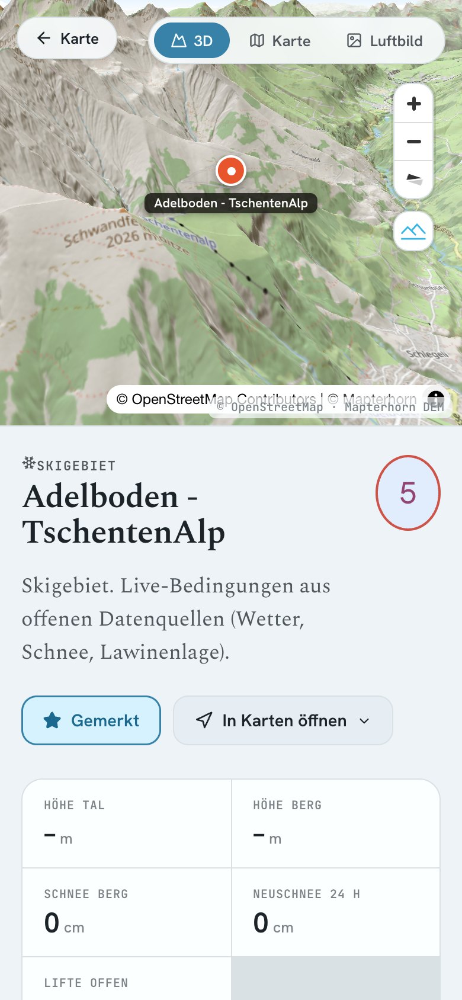
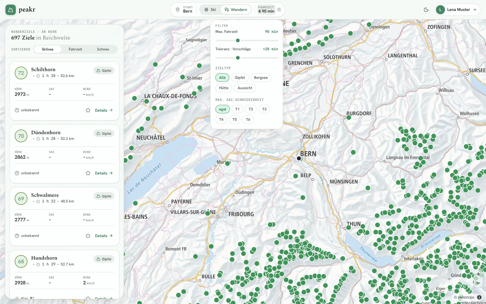
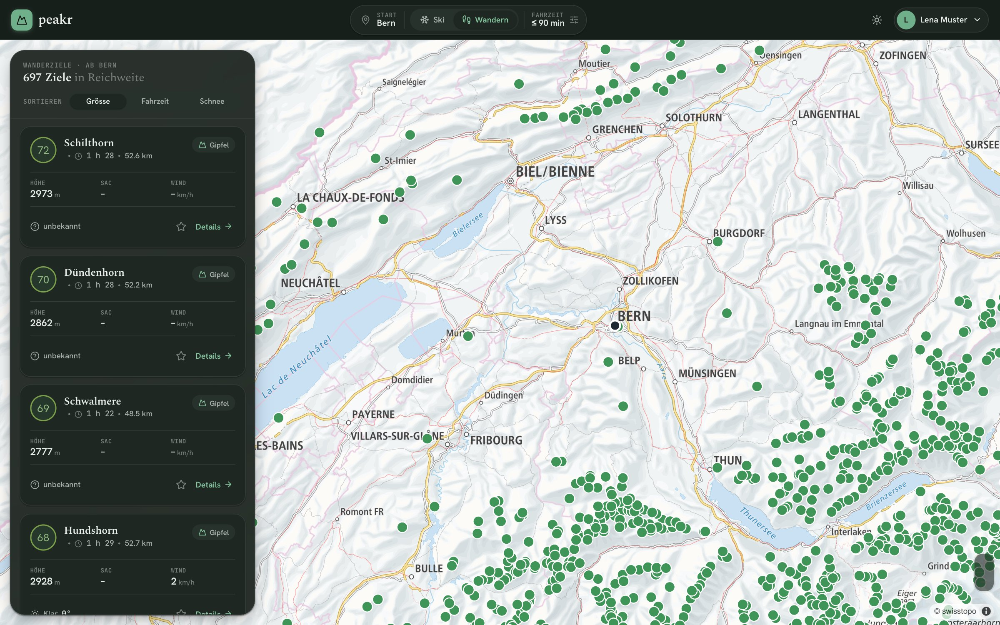

<p align="center">
  
</p>

<h1 align="center">Peakr</h1>
<p align="center"><strong>Wohin heute in die Berge?</strong></p>
<p align="center">Ein persönlicher Ski- und Wander-Navigator für die Schweiz – nach Fahrzeit, Wetter, Schnee und Lawinenlage.</p>

<p align="center">
  
</p>

> [!NOTE]
> **Peakr ist derzeit ausser Betrieb.** Die Anwendung wird zwar öffentlich bereitgestellt, die Hintergrundjobs laufen aber aktuell nicht.
> Das Repository bleibt als persönliches Entwicklungsprojekt verfügbar. Der lokale Betrieb ist nach
> entsprechender Konfiguration weiterhin möglich – siehe [Lokal starten](#lokal-starten).


Peakr beantwortet eine einfache Frage: **Wo lohnt es sich heute hinzufahren?** Du wählst Startort,
Modus (Ski oder Wandern) und die maximale Fahrzeit. Peakr berechnet daraus alle erreichbaren Ziele
in der ganzen Schweiz, bewertet sie anhand von Schnee, Wetter, Lawinengefahr und Bekanntheit und
zeigt sie auf einer swisstopo-Karte und in einer sortierbaren Liste.

Alle Datenquellen sind kostenlos. Pflicht ist nur ein Gratis-Schlüssel von OpenRouteService für
echte Fahrzeiten – ohne ihn rechnet Peakr mit Luftlinien-Schätzungen.

## Ein Blick in die App

<table>
  <tr>
    <th>Kartensuche</th>
    <th>Detailansicht</th>
    <th>Favoriten</th>
  </tr>
  <tr>
    <td></td>
    <td></td>
    <td></td>
  </tr>
</table>

<table>
  <tr>
    <th>Mobil: Suche</th>
    <th>Mobil: Detail</th>
  </tr>
  <tr>
    <td></td>
    <td></td>
  </tr>
</table>

Alle Screenshots stammen aus einer lokal laufenden Instanz (aufgenommen am 05.11.2026). Die Ziele
stammen aus OpenStreetMap, Wetter und Schnee von Open-Meteo, Fahrzeiten von OpenRouteService. Das
Konto „Lena Muster“ ist fiktiv. Anfang November liegt in den meisten Gebieten noch kein Schnee, und
das SLF-Bulletin lieferte noch keine Stufen – daher „0 cm“ und „Lawine k.A.“ in den Aufnahmen.

## Was Peakr kann

| Bereich           | Funktionen                                                                                                                          |
| ----------------- | ----------------------------------------------------------------------------------------------------------------------------------- |
| **Zielsuche**     | Startort per Ortssuche (swisstopo) oder GPS, Modus Ski/Wandern, maximale Fahrzeit 15–240 min plus Toleranz für „+X min“-Vorschläge. |
| **Karte**         | swisstopo-Vektorkarte mit allen erreichbaren Zielen, farbige Marker je Modus, Typ-Symbole, Wanderwege-Overlay ab Zoomstufe 13.      |
| **Bewertung**     | Gesamtwert 0–100 aus Basis, Schnee, Neuschnee, Liften, Bedingungen, Trend und Lawinen-Abzug; in der API als `scoreBreakdown`.       |
| **Detailansicht** | 3D-Gelände, topografische Karte und Luftbild, Kennzahlen, aktuelle Lage, 7-Tage-Wetter, Schnee- bzw. Temperaturverlauf.             |
| **Wandern**       | Filter nach Zieltyp (Gipfel, Bergsee, Hütte, Aussichtspunkt) und maximaler SAC-Schwierigkeit T1–T6.                                 |
| **Konto**         | Registrierung und Anmeldung, Favoriten, Standard-Startort, optionaler OpenAI-Schlüssel (verschlüsselt gespeichert).                 |
| **Darstellung**   | Hell- und Dunkelmodus; das Farbschema folgt dem Modus (Ski: „Gletscher“, Wandern: „Tannwald“). Responsive bis aufs Smartphone.      |

### Zielsuche und Navigation

Die Suchleiste oben vereint Startort, Modus und Fahrzeit. Änderungen lösen die Suche automatisch
aus. Die Ergebnisse lassen sich nach Bewertung (in der App „Grösse“), Fahrzeit oder Schnee
sortieren. Ein Klick auf einen Marker hebt den Treffer in der Liste hervor; **Details** öffnet die
Zielseite. Von dort führt **In Karten öffnen** mit Route ab dem Startort zu Apple Maps oder Google
Maps.

Fahrzeiten kommen aus der Matrix von OpenRouteService (eine Anfrage pro Suche). Ohne Schlüssel oder
bei einem Fehler schätzt Peakr die Fahrzeit aus der Luftlinie und kennzeichnet das in der Antwort.

### Karten, Wetter, Schnee und Lawinengefahr

| Daten                | Quelle                | Hinweis                                                                |
| -------------------- | --------------------- | ---------------------------------------------------------------------- |
| Grundkarte           | swisstopo Vektorkarte | Fallback auf OSM-Raster, falls der Style nicht lädt                    |
| Luftbild, Wanderwege | swisstopo WMTS        | Wanderwege als Overlay ab Zoomstufe 13                                 |
| Wetter, Schnee       | Open-Meteo            | Temperatur, Wind, Wettercode, Schneehöhe und Neuschnee am Zielpunkt    |
| Lawinengefahr        | SLF                   | Warnregionen als Polygone, Stufe aus dem täglichen Bulletin (saisonal) |
| Lifte                | Beispiel-Adapter      | Keine freie, schweizweite Quelle – meist „unbekannt“                   |

Die Such-API blendet Skigebiete mit Lawinenstufe 4 oder höher nicht aus, sondern markiert sie als
gesperrt (`blocked`, `blockedReason`) und sortiert sie ans Ende. Die Oberfläche hebt diese
Markierung derzeit nicht gesondert hervor.

> [!IMPORTANT]
> Die Lawinenstufe in Peakr ersetzt **nicht** die eigene Beurteilung vor Ort. Vor jeder Tour das
> offizielle Bulletin auf [whiterisk.ch](https://whiterisk.ch) prüfen.


### Wanderfunktionen und Filter

Im Modus **Wandern** zeigt Peakr Gipfel, Bergseen, Hütten und Aussichtspunkte aus OpenStreetMap.
Über das Filter-Symbol neben der Fahrzeit lassen sich Zieltyp und maximale SAC-Schwierigkeit
einschränken. Die Detailansicht zeigt statt Schneeverlauf einen stündlichen Temperaturverlauf.

<details>
  <summary>Filtermenü und Dunkelmodus ansehen</summary>





</details>

### Favoriten und persönliche Einstellungen

- **Favoriten** mit dem Stern markieren. Angemeldet werden sie im Konto gespeichert, ohne Anmeldung
  im Browser (localStorage).
- **Standard-Startort** im Dashboard festlegen; er wird beim Öffnen vorausgewählt, sofern kein
  anderer Startort gespeichert ist.
- **Suchparameter und Darstellung** (Modus, Fahrzeit, Hell/Dunkel) bleiben im Browser erhalten.
- **OpenAI-Schlüssel (optional)** wird mit AES-256-GCM verschlüsselt gespeichert und nie an den
  Browser zurückgegeben.

## Lokal starten

Voraussetzungen:

| Werkzeug | Version                                                                  |
| -------- | ------------------------------------------------------------------------ |
| Node.js  | 20 oder neuer (Docker-Images nutzen 22)                                  |
| pnpm     | 9 (`npm install -g pnpm@9`; im Projekt verwendet: 9.15.9)                |
| Docker   | Docker Desktop oder Colima (`brew install colima docker docker-compose`) |

```bash
git clone https://github.com/bien187/peakr.git
cd peakr
pnpm install
cp .env.example .env              # Werte anpassen, siehe unten

# 1. Datenbank (PostgreSQL 16 + PostGIS) starten
docker compose up -d db

# 2. Schema anlegen
pnpm --filter @ch-alpineroute/backend db:migrate

# 3. Daten laden
pnpm --filter @ch-alpineroute/backend import:slf-regions    # 149 SLF-Warnregionen
pnpm --filter @ch-alpineroute/backend import:destinations   # Skigebiete und Wanderziele (OSM)

# 4. Optional: Wetter, Schnee und Trend einmalig füllen
pnpm --filter @ch-alpineroute/backend worker:live:once
pnpm --filter @ch-alpineroute/backend worker:trend:once

# 5. Backend (:4000) und Frontend (:3000) starten
pnpm --parallel --filter "./apps/*" run dev
```

- Frontend: <http://localhost:3000>
- Backend: <http://localhost:4000/api/health>

> [!TIP]
> Der Ziel-Import fragt Overpass ab und dauert je nach Last 10–20 Minuten. Bei Timeouts oder
> HTTP 429/502 einfach erneut starten – der Import ist idempotent und überspringt vorhandene Ziele.

Danach im Browser oben rechts registrieren, einen Startort wählen und Ski oder Wandern einstellen.

> [!NOTE]
> Die Root-`package.json` enthält derzeit keine Skripte (sie ist eine Kopie von
> `packages/shared/package.json`). Kurzbefehle wie `pnpm dev` oder `pnpm db:migrate`, die in
> älteren Anleitungen stehen, funktionieren deshalb nicht. Die Befehle oben rufen die Skripte der
> einzelnen Pakete direkt auf.

### Zwei API-Varianten

Das Frontend spricht je nach `NEXT_PUBLIC_API_BASE_URL` mit einem von zwei Backends:

| Einstellung                                          | Backend                                         | Einsatz                            |
| ---------------------------------------------------- | ----------------------------------------------- | ---------------------------------- |
| `http://localhost:4000` (Standard in `.env.example`) | Fastify-API in `apps/backend`                   | lokale Entwicklung                 |
| leer bzw. nicht gesetzt                              | Next.js-API-Routen in `apps/frontend/app/api/*` | früherer Produktivbetrieb (Vercel) |

Die Next.js-Routen decken Suche, Ziele, Ortssuche, Auth, Profil und Favoriten ab, aber nicht den
OpenAI-Schlüssel und den Admin-Refresh. Konten sind zwischen beiden Varianten nicht austauschbar
(argon2 bzw. bcrypt).

## Umgebungsvariablen

Alle Variablen stehen in [`.env.example`](.env.example). Es gibt **eine** `.env` im Repo-Root;
Backend und Frontend laden sie beide.

| Variable                                        |  Pflicht  | Bedeutung                                                                            |
| ----------------------------------------------- | :-------: | ------------------------------------------------------------------------------------ |
| `POSTGRES_USER` / `_PASSWORD` / `_DB` / `_PORT` |     –     | Zugangsdaten der Docker-Datenbank (Standard ist lokal ausreichend)                   |
| `DATABASE_URL`                                  |     ✓     | Verbindung zur Datenbank; muss zu den `POSTGRES_*`-Werten passen                     |
| `BACKEND_PORT`, `CORS_ORIGIN`                   |     –     | Port der Fastify-API und erlaubte Frontend-Origin                                    |
| `JWT_SECRET`                                    |     ✓     | Signatur der Login-Tokens (empfohlen ≥ 32 Zeichen): `openssl rand -base64 48`        |
| `JWT_EXPIRES_IN`                                |     –     | Gültigkeit der Tokens (Standard `7d`)                                                |
| `ENCRYPTION_KEY`                                |     ✓     | 64 Hex-Zeichen für die Verschlüsselung des OpenAI-Schlüssels: `openssl rand -hex 32` |
| `ORS_API_KEY`                                   | empfohlen | OpenRouteService-Token für echte Fahrzeiten                                          |
| `ENABLE_OPENAI_TREND`, `OPENAI_API_KEY`         |     –     | Optionale, **kostenpflichtige** Trend-Anreicherung; standardmässig aus               |
| `NEXT_PUBLIC_API_BASE_URL`                      |     –     | API-Variante, siehe oben                                                             |
| `NEXT_PUBLIC_SWISSTOPO_STYLE_URL`               |     –     | Style der Grundkarte                                                                 |

`NEXT_PUBLIC_*`-Werte landen im Browser-Bundle – dort keine Geheimnisse eintragen.

## Externe Datenquellen und API-Schlüssel

| Quelle               | Verwendung                                        | Schlüssel                           |
| -------------------- | ------------------------------------------------- | ----------------------------------- |
| OpenRouteService     | Fahrzeitmatrix                                    | **Gratis-Token nötig**              |
| Open-Meteo           | Wetter, Schneehöhe, Neuschnee, 7-Tage-Prognose    | kein Schlüssel                      |
| SLF                  | Warnregionen und Lawinenbulletin                  | kein Schlüssel                      |
| swisstopo / GeoAdmin | Ortssuche, Vektorkarte, Luftbild, Wanderwege      | kein Schlüssel                      |
| Overpass / OSM       | Skigebiete, Gipfel, Seen, Hütten, Aussichtspunkte | kein Schlüssel                      |
| Wikipedia Pageviews  | Bekanntheits-Score                                | kein Schlüssel                      |
| OpenAI               | optionale Trend-Anreicherung                      | kostenpflichtig, standardmässig aus |

**OpenRouteService-Token holen:** Auf [openrouteservice.org](https://openrouteservice.org) ein
kostenloses Konto anlegen, im Dashboard unter „Tokens“ einen Token erstellen und als `ORS_API_KEY`
in die `.env` eintragen. Der Gratis-Plan reicht für den persönlichen Gebrauch. Ausführlich:
[SETUP_EXTERNAL.md](SETUP_EXTERNAL.md).

## Docker- und Produktionsbetrieb

### Komplett in Docker

```bash
docker compose up -d --build        # DB, Migration, API, Frontend und zwei Worker
docker compose run --rm migrate pnpm import:slf-regions
docker compose run --rm migrate pnpm import:destinations
```

- Logs: `docker compose logs -f backend`
- Stoppen: `docker compose down` (Daten bleiben im Volume `pgdata`)
- Das Frontend-Image bettet `NEXT_PUBLIC_*` beim Build ein; der Standard zeigt auf `localhost:4000`.
- Redis ist optional und startet nur mit `--profile with-redis`.

### Früherer Produktivbetrieb

Zuletzt war Peakr für **Vercel** (Next.js-App inkl. API-Routen), **Supabase** (PostgreSQL mit
PostGIS) und **GitHub Actions** (Worker alle 3 Stunden bzw. täglich) vorbereitet. Diese Umgebung wird
derzeit nicht betrieben. Die Schritte für eine eigene Bereitstellung beschreibt
[MIGRATION.md](MIGRATION.md); der Worker-Workflow liegt in
[`.github/workflows/workers.yml`](.github/workflows/workers.yml) und benötigt die dort genannten
Repository-Secrets.

## Technik

| Ebene      | Umsetzung                                                                          |
| ---------- | ---------------------------------------------------------------------------------- |
| Monorepo   | pnpm-Workspaces: `apps/backend`, `apps/frontend`, `packages/shared`                |
| Frontend   | Next.js 15 (App Router), React 19, TypeScript, Tailwind CSS, Zustand, lucide-react |
| Karten     | MapLibre GL JS mit swisstopo-Vektorkarte, swissimage-Luftbild und 3D-Gelände       |
| Gestaltung | Eigene oklch-Farbtokens, Schriften Spectral, Hanken Grotesk und JetBrains Mono     |
| Backend    | Fastify 5, Drizzle ORM, Zod, jose (JWT), argon2, pino, node-cron                   |
| Datenbank  | PostgreSQL 16 mit PostGIS 3.4 (für Import und SLF-Zuordnung)                       |
| Gemeinsam  | Zod-Schemas und Typen in `@ch-alpineroute/shared` für API und UI                   |
| Tests      | Vitest im Backend                                                                  |

### Architektur

```text
Browser ──► Next.js (apps/frontend, :3000)
              │
              ├─► Fastify-API (apps/backend, :4000) ──┐   lokale Entwicklung
              └─► Next.js-API-Routen (app/api/*) ─────┤   Vercel-Variante
                                                      ▼
                                          PostgreSQL + PostGIS
                                                      ▲
     Import-Skripte und Worker (apps/backend) ────────┘
     OSM · SLF · Open-Meteo · Wikipedia · OpenRouteService
```

Die Suche lädt Kandidaten samt neuestem Live-Status in einer Abfrage, holt die Fahrzeiten in einer
ORS-Anfrage und bewertet sie in einer reinen, ohne Mocks testbaren Funktion. Weitere Entscheidungen
sind in [DECISIONS.md](DECISIONS.md) dokumentiert.

## Projektstruktur

```text
apps/backend/        Fastify-API, Drizzle-Migrationen, Import-Skripte, Worker, Tests
apps/frontend/       Next.js-UI, API-Routen für die Vercel-Variante, App-Icons
packages/shared/     Zod-Schemas und TypeScript-Typen für Backend und Frontend
docs/screenshots/    Echte Aufnahmen für diese README
.github/workflows/   Geplante Worker-Läufe (GitHub Actions)
docker-compose.yml   DB, Migration, API, Frontend und Worker
```

Die Ordner `app/`, `components/`, `lib/`, `src/`, `peakr/` und `handoff/` sowie `Peakr.html` und
`tweaks-panel.jsx` im Root sind ältere Kopien und Design-Prototypen. Sie gehören zu keinem Workspace
und werden nicht gebaut.

## Tests

```bash
pnpm --filter @ch-alpineroute/backend test         # Vitest
pnpm --filter @ch-alpineroute/backend typecheck
pnpm --filter @ch-alpineroute/frontend typecheck
```

Lokaler Stand am **05.11.2026**:

| Prüfung            | Ergebnis                                                                                  |
| ------------------ | ----------------------------------------------------------------------------------------- |
| Vitest (5 Dateien) | 23 von 24 Tests bestanden; 1 Fehler in `score.service.test.ts` (erwartet 64, erhalten 66) |
| Typecheck Frontend | erfolgreich                                                                               |
| Typecheck Backend  | 3 Fehler in den Import-Skripten (diese laufen über `tsx` trotzdem)                        |
| Lokaler Start      | Migration, SLF-Import, Ziel-Import, Live-Worker und beide Dev-Server erfolgreich          |

Getestet sind Bewertung, Suche (Aufteilung, Sperre, Vorschläge), Open-Meteo-Parser,
Wikipedia-Score und Verschlüsselung. Frontend- und Browsertests gibt es nicht.

## Fehlerbehebung

| Problem                          | Lösung                                                                                  |
| -------------------------------- | --------------------------------------------------------------------------------------- |
| `Command "db:migrate" not found` | Befehle mit `pnpm --filter @ch-alpineroute/backend …` ausführen (siehe oben)            |
| Datenbank nicht erreichbar       | `docker compose ps` prüfen und `DATABASE_URL` mit den `POSTGRES_*`-Werten abgleichen    |
| `column d.lat does not exist`    | Die Datenbank stammt von einem älteren Schema. Mit einer leeren Datenbank neu migrieren |
| Suche liefert keine Ziele        | `import:destinations` ausführen                                                         |
| Fahrzeiten wirken ungenau        | `ORS_API_KEY` fehlt – es werden Luftlinien-Schätzungen verwendet                        |
| Karte bleibt grau                | swisstopo-Style nicht erreichbar; der OSM-Fallback greift automatisch                   |

## Weitere Dokumentation

| Dokument                               | Inhalt                                                          |
| -------------------------------------- | --------------------------------------------------------------- |
| [SETUP_EXTERNAL.md](SETUP_EXTERNAL.md) | Werkzeuge installieren, API-Schlüssel beschaffen, `.env` füllen |
| [MIGRATION.md](MIGRATION.md)           | Bereitstellung mit Vercel, Supabase und GitHub Actions          |
| [DECISIONS.md](DECISIONS.md)           | Design- und Architekturentscheidungen, Datenlage                |

SETUP_EXTERNAL.md verwendet noch die Root-Kurzbefehle (`pnpm db:migrate` usw.). Massgebend sind
die Befehle in dieser README.

## Projektstatus und bekannte Grenzen

- **Kein öffentlicher Betrieb.** Es gibt derzeit keine erreichbare Live-Instanz.
- **Root-`package.json` überschrieben.** Root-Skripte und Root-Entwicklungsabhängigkeiten
  (ESLint, Prettier, TypeScript für `packages/shared`) fehlen.
- **Favoriten mit der Fastify-API:** Das Frontend sendet `POST /api/favorites/:id` mit JSON-Header
  ohne Inhalt. Fastify lehnt solche Anfragen ab, darum kann das Merken im Fastify-Modus fehlschlagen.
- **Liftstatus** ist mangels freier Quelle fast überall „unbekannt“.
- **Lawinenstufen** gibt es nur während der Saison des SLF-Bulletins.
- **Wetterabdeckung:** Beim lokalen Lauf am 05.11.2026 lieferte Open-Meteo in gebündelten Anfragen
  Daten für rund 1'800 von 7'100 Zielen.
- **Overpass** ist rate-limitiert; Importe müssen gelegentlich wiederholt werden.
- **Tests** decken nur Backend-Logik ab; ein Test schlägt derzeit fehl.

Peakr ist ein privates, nicht kommerzielles Projekt ohne Verbindung zu swisstopo, SLF,
OpenStreetMap, Open-Meteo oder OpenRouteService. Karten- und Daten-Attributionen werden in der App
angezeigt.
